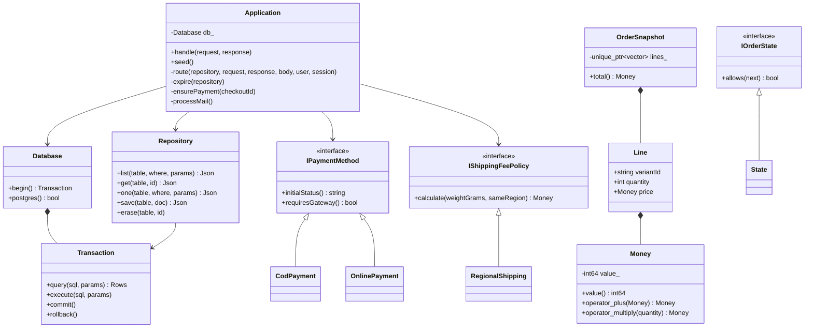
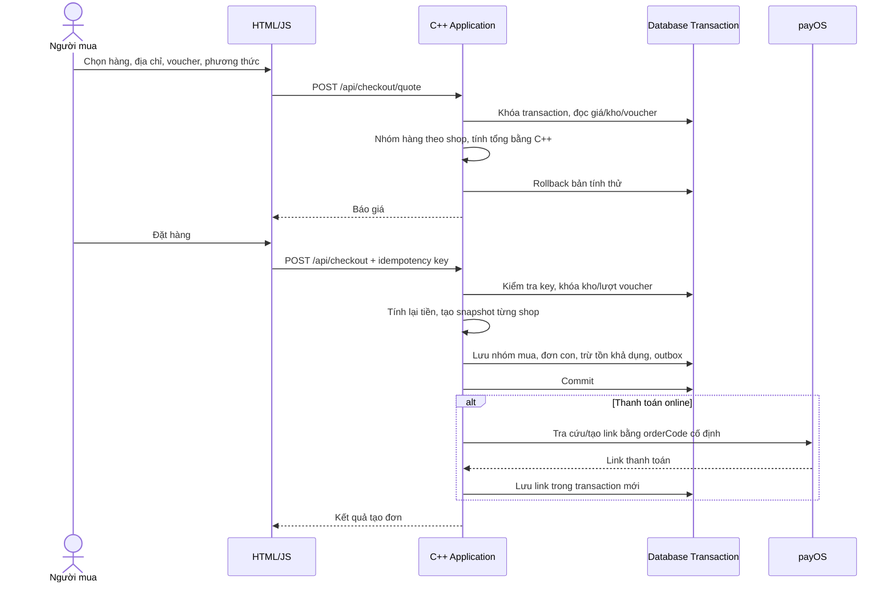
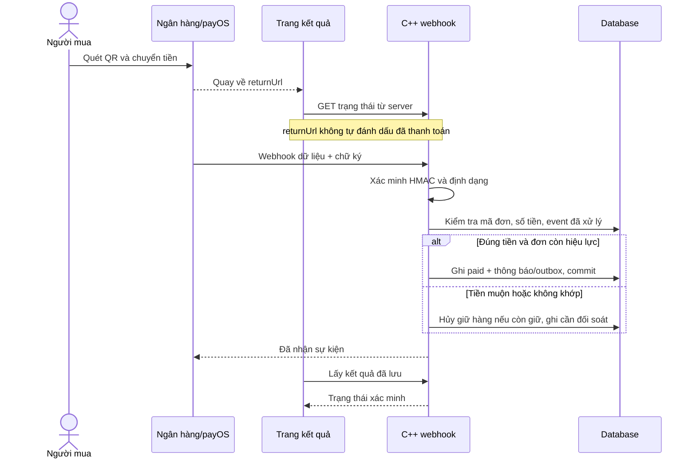

# Kiến trúc phần mềm

## Luồng xử lý

Frontend chỉ hiển thị và gửi lựa chọn của người dùng. `Application` xác thực session/CSRF, kiểm tra quyền sở hữu, tính tiền và điều phối nghiệp vụ C++. `Repository` ánh xạ record sang SQL có tham số; `Database::Transaction` quản lý commit/rollback qua RAII.

Các bảng có khóa chính/khóa ngoại/unique và cột chỉ mục cho dữ liệu quan trọng. Payload JSON chứa thuộc tính mở rộng và snapshot lịch sử. PostgreSQL dùng schema riêng `shoppe`; SQLite là file phát triển. Cấu hình production không cho phép fallback sang SQLite.

Ngày 22/10 bổ sung `payments.h/.cpp` cho sổ giao dịch dùng chung giữa webhook và truy vấn provider. Mã tham chiếu ngân hàng xác định một khoản thu; số tiền khác trên cùng tham chiếu bị từ chối. Sync xác thực orderCode, amount và tổng transactions/amountPaid trước khi cập nhật. Khoản thu thêm sau paid được theo dõi riêng để hoàn phần thừa; không hủy các đơn đã thanh toán hợp lệ.

Database có bảng schema_migrations với version/checksum, baseline schema.sql và thư mục migrations. Migration chạy trong transaction dưới khóa database, từ chối chỉnh sửa lịch sử hoặc chạy mã nguồn cũ hơn database. Checksum chuẩn hóa CRLF để nhất quán giữa Windows và Linux.

## Lớp và các nguyên lý OOP

- Encapsulation: giá trị tiền kiểm tra miền giá trị/tràn số; resource database và snapshot có ownership rõ ràng.
- Strategy: COD/payOS và phí vận chuyển gọi qua interface có hàm thuần ảo/virtual destructor.
- State: factory `orderState()` tạo đối tượng kiểm soát chuyển tiếp; `requireTransition()` chặn nhảy cóc trạng thái. Quyền của buyer/seller/admin được kiểm tra riêng trong application.
- Rule of Five: `OrderSnapshot` có deep copy, move constructor, copy/move assignment, destructor; snapshot được dùng để tính subtotal và kiểm thử copy/move.
- RAII: transaction chưa commit tự rollback khi có exception; statement SQLite tự finalize. Smart pointers giữ tài nguyên theo quyền sở hữu.
- Money có nạp chồng cộng, nhân và so sánh. Phân bổ voucher dùng số nguyên, tổng phần giảm luôn bằng giảm toàn đơn.

## Sequence: checkout nhiều shop

Không giữ transaction SQL mở khi gọi payOS, Storage hoặc dịch vụ email. PostgreSQL dùng transaction-level advisory lock chung cho bản demo; SQLite dùng mutex/BEGIN IMMEDIATE. Khóa này giới hạn throughput nhưng bảo đảm logic C++ dùng chuỗi đọc/sửa/ghi không bán vượt kho trên các instance.

## Sequence: xác nhận thanh toán

## Các trạng thái độc lập

- `orders.status`: new -> confirmed -> preparing -> shipping -> delivered -> completed; có cancelled và delivery_failed.
- `checkouts.status`: pending/paid/expired/cancelled/review/refunded hoặc cod.
- COD thu tiền lưu ở `orders.cod_status`, không suy luận từ trạng thái giao hàng.
- Trả hàng: requested -> approved/rejected -> received. Hoàn tiền lưu thành record riêng, tham chiếu và số tiền không vượt mức còn được hoàn.
- Giỏ nhiều shop dùng một checkout, nhiều order. Snapshot các dòng hàng giữ nguyên dù người bán sửa giá hoặc ẩn sản phẩm sau đó.

## Khác biệt với đề xuất ban đầu

- cpp-httplib thay Drogon để giảm phụ thuộc và build được trực tiếp trên toolchain hiện có; nghiệp vụ vẫn chạy C++20.
- PBKDF2-HMAC-SHA256 600.000 vòng qua OpenSSL thay Argon2id; có salt ngẫu nhiên và so sánh thời gian hằng.
- Resend HTTP API thay SMTP để gửi mail qua HTTPS; hàng đợi bền vững và retry không phụ thuộc tiến trình sống liên tục.
- Có thêm SQLite adapter cho phát triển/kiểm thử, production bắt buộc PostgreSQL.

Các interface domain không phụ thuộc giao diện. `Application` hiện là một điểm điều phối đơn giản cho quy mô bài tập; có thể tách thành service theo module khi cần mở rộng. Repository hiện trả JSON record có validation ở service, không tự nhận SQL/filter từ client.
