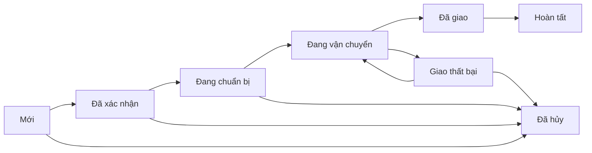

# Kiểm thử và báo cáo toàn bộ chức năng — 22/10/2026

> Đây là số đo trước sửa. Hai lỗi moderation/method và phần tối ưu độ trễ đã được xử lý trong bản cập nhật; xem [kết quả sau sửa](PERFORMANCE_FIX_2026-10-22.md).

## Kết luận

Shoppe hiện là marketplace demo nhiều shop có nghiệp vụ chính bằng C++20, frontend HTML/CSS/JavaScript, triển khai tại **https://shoppec.vercel.app**. Các luồng mua hàng, phân quyền, COD, tồn kho, voucher, trả hàng và đối soát đã có implementation và test. Chưa thể kết luận toàn bộ hệ thống tương đương Shopee hoặc đã sẵn sàng kinh doanh thật: thanh toán/email thật chưa nghiệm thu, còn lỗi kiểm duyệt đánh giá và độ trễ Production cao.

Kiểm tra source tại HEAD **807b538**, nhánh `codex/deployment-payment-readiness`. Production chạy **3548b0b**, deployment `dpl_BfeeuzDquxPfjNYGms1fcWbtM1vU`; phần backend/frontend giữa hai commit giống nhau, commit sau bổ sung báo cáo. Thay đổi trong đợt audit này chỉ gồm chẩn đoán TLS và tài liệu, chưa triển khai sửa nghiệp vụ lên Production.

Snapshot Supabase chỉ đọc trong lượt kiểm tra: **30 sản phẩm, 1 shop, 2 user, 1 đơn hàng**. Đây là số liệu tại thời điểm truy vấn, có thể thay đổi khi chủ dự án sử dụng website. Lượt audit không tạo đơn, sửa trạng thái đơn, chuyển/hoàn tiền hoặc ghi đánh giá trên Production.

## 1. Phạm vi và kết quả chạy mới

| Kiểm tra                                | Kết quả mới                                                     | Phạm vi chứng minh                                                                                                                                                          |
| --------------------------------------- | --------------------------------------------------------------- | --------------------------------------------------------------------------------------------------------------------------------------------------------------------------- |
| Build C++ Windows có adapter PostgreSQL | Qua                                                             | CMake build incremental từ source hiện tại                                                                                                                                  |
| CTest                                   | **3/3 qua**                                                     | Domain/security, payment ledger, migration replay/rollback/checksum; các test CTest này dùng fixture SQLite, không phải tất cả chạy trên PostgreSQL                         |
| HTTP API với SQLite riêng               | **14/14 qua**, khoảng 1,97 giây                                 | Nghiệp vụ và phân quyền trong suite hiện có                                                                                                                                 |
| HTTP API với PostgreSQL 18.4 riêng      | **14/14 qua**, khoảng 6,55 giây                                 | Cùng suite qua adapter PostgreSQL; webhook fixture phụ vẫn chạy SQLite riêng theo thiết kế suite                                                                            |
| Probe biên bổ sung                      | **4 qua / 2 lỗi**                                               | Xác minh/reset token, notifications, return trùng, kiểm duyệt đánh giá và HTTP method                                                                                       |
| Probe Production                        | **36/36 request đúng kỳ vọng**                                  | API public/admin/shop, phân quyền, CSV, session, CSRF/Origin; không phải 36 endpoint duy nhất hoặc full CRUD trên Production                                                |
| UI bằng trình duyệt                     | **28 lượt mở màn hình**, không hiện lỗi route                   | 11 admin, 12 màn hình buyer/onboarding, 5 seller; fixture riêng; kiểm tra render, không bấm mọi nút CRUD                                                                    |
| Responsive                              | **7/7 màn hình không tràn ngang toàn trang ở 390×844**          | Home, search, product, cart, checkout, account, onboarding seller; cart/checkout trạng thái rỗng. Chưa kiểm tra mọi trạng thái có hàng hoặc mọi trang admin trên điện thoại |
| Frontend syntax + Vite build            | Qua                                                             | Bundle HTML/CSS/JS hiện tại                                                                                                                                                 |
| Preflight Production/online             | Qua                                                             | Cấu hình bắt buộc đã có; email chưa cấu hình                                                                                                                                |
| Kiểm tra dịch vụ thật                   | Qua kết nối DB/TLS, Storage key/bucket, payOS Client ID/API Key | payOS chỉ GET mã order không tồn tại → HTTP 200/code101; checksum chưa được provider nghiệm thu bằng giao dịch thật                                                         |
| npm audit                               | **0 vulnerability được registry báo cáo**                       | Gồm cả build dependencies trong lần chạy này; không kiểm toán dependency C++/hệ điều hành/container                                                                         |
| Quét secret                             | Qua                                                             | Git-visible files và các giá trị cấu hình/mẫu secret mà script biết; không phải chứng nhận không có mọi dạng secret                                                         |
| Log Vercel                              | Không thấy error/fatal trong cửa sổ 30 phút đã đọc              | Chỉ deployment hiện tại; không thay thế monitoring hoặc load test                                                                                                           |

Lượt đầu CTest thiếu DLL libpq trong PATH và lượt HTTP đầu bị sandbox chặn localhost. Sau khi bổ sung đường dẫn runtime và cho phép mạng localhost, các suite mới qua như trên. Đây là lỗi môi trường chạy kiểm thử, không tính là 14 lỗi nghiệp vụ. PostgreSQL audit là cluster mới, bind `127.0.0.1:15435`, đã dừng sạch sau kiểm thử; không dùng Supabase Production cho suite có seed/mutation.

Trong lần kiểm tra Production, auto-review ban đầu từ chối vì lo ngại mutation dữ liệu thật. Đã thêm giới hạn cứng vào script: chỉ GET, ngoại lệ POST login/logout để tạo và dọn phiên riêng. Script giới hạn này đã được chấp thuận và chạy thành công. Những thử nghiệm order/review/return thực hiện riêng trên localhost với fixture.

## 2. Các chức năng hiện có và mức kiểm chứng

Quy ước: **Local** = test trên database thử nghiệm; **Prod** = đã gọi trên website Vercel thật; **Source/UI** = có code và màn hình, không đồng nghĩa mọi nhánh đã test động.

| Nhóm chức năng        | Đã có                                                                                                                    | Kết quả / điểm còn thiếu                                                                                                                                                     |
| --------------------- | ------------------------------------------------------------------------------------------------------------------------ | ---------------------------------------------------------------------------------------------------------------------------------------------------------------------------- |
| Trang chủ / danh mục  | Banner, 6 nhóm danh mục, gợi ý hàng, giá VNĐ, ảnh, tìm kiếm có/không dấu và lọc                                          | Local + Prod catalog/detail qua; home/search UI render. Chưa phân trang server, chưa search engine hoặc gợi ý cá nhân thực sự                                                |
| Chi tiết / shop       | Mô tả, biến thể, giá, stock, đánh giá, shop và khu vực                                                                   | API Local + Prod qua. Catalog là dữ liệu demo tự động, không phải dữ liệu bán hàng Shopee được ủy quyền                                                                      |
| Tài khoản             | Email/password, hồ sơ, đăng ký buyer; session PostgreSQL, cookie Secure/HttpOnly, CSRF/Origin, rate limit                | Local login/register/phân quyền/restart qua; Prod admin login/session/logout qua. Không có OAuth/2FA hoặc API token bên thứ ba                                               |
| Email / quên mật khẩu | Token có hạn, dùng một lần, outbox; reset thu hồi session                                                                | Probe fixture mới: verify 200, replay 404; reset 200, replay 404, password cũ 401, mới 200, session cũ mất hiệu lực. **Email thật chưa gửi được** vì thiếu Resend key/sender |
| Sổ địa chỉ            | Thêm/sửa/xóa địa chỉ của mình, mặc định, kiểm tra phone                                                                  | Local isolation qua; Prod đọc danh sách qua. Chưa có danh mục địa giới/chuẩn hóa địa chỉ hãng vận chuyển                                                                     |
| Giỏ / yêu thích       | Tối đa 50 dòng, quantity 1–99, chọn mua, biến thể; lưu wishlist                                                          | Local sở hữu/validation qua, Prod GET qua; UI trạng thái rỗng qua. **POST /cart ngoài thiết kế vẫn trả 200**                                                                 |
| Mở shop               | User đăng ký một shop, trạng thái pending, admin duyệt/reject/suspend, chủ shop sửa thông tin                            | Local onboarding/phân quyền qua; UI buyer chưa có shop hiển thị form. Chưa KYC, nhân viên shop hoặc seller payout                                                            |
| Quản lý hàng          | Tạo/sửa, biến thể, giá/tồn kho, ngừng bán, admin bật/tắt                                                                 | Local ownership/CRUD qua; Prod đọc 30 hàng và seller list qua. Ngừng bán là soft delete; chưa có lịch sử nhập/xuất kho chuyên dụng                                           |
| Upload ảnh            | Base64 → C++ kiểm tra PNG/JPEG/WebP và giới hạn 2MiB → Storage public URL                                                | Lượt này chỉ xác minh key/bucket; upload/read/delete đã kiểm tra ở đợt thiết lập trước. Chưa thử upload mới qua Production trong đợt audit                                   |
| CSV                   | Preview/commit nhập sản phẩm, tối đa 200 dòng; export hàng/đơn; kiểm tra header/giá/số lượng                             | Local preview/import/export qua; Prod export CSV qua. Chưa import toàn bộ dữ liệu hệ thống hoặc backup/restore thông qua UI                                                  |
| Voucher               | Voucher shop/toàn sàn, fixed/percent, thời hạn, minimum, cap, limit; phân bổ discount                                    | Local tính giá/rollback/phân bổ qua; Prod GET qua. Chưa chiến dịch flash sale hoặc khuyến mãi theo vận chuyển                                                                |
| Checkout              | C++ tính tiền, phí giao theo vùng/cân nặng, quote rollback; tách đơn theo shop, idempotency, giữ tồn kho                 | Local cả SQLite/PostgreSQL qua; tranh chấp hàng cuối qua. Production không tạo đơn thử trong lượt này; phí ship là mô hình demo                                              |
| COD                   | Đơn mới → xác nhận → chuẩn bị → vận chuyển → đã giao → hoàn tất; thu COD là bước riêng                                   | Local luồng trạng thái/thu tiền/hủy/hoàn tồn qua. Admin cập nhật giao vận thủ công; không có hãng vận chuyển thực                                                            |
| Online payOS          | Tạo link, ký HMAC; đọc trạng thái/sync/webhook, không tin returnUrl; duplicate, tiền muộn/thừa/review                    | Fixture webhook và ledger qua. Prod chỉ xác minh key bằng GET; **chưa tạo link, nhận callback provider hoặc đối soát ngân hàng thật trong đợt audit**                        |
| Hủy / tồn kho         | Hủy đúng trạng thái, trả kho một lần; chặn xử lý đơn online chưa paid                                                    | Local qua; không thao tác trên đơn thật                                                                                                                                      |
| Trả hàng / hoàn tiền  | Yêu cầu trong 7 ngày, theo dòng/số lượng; shop xét duyệt, admin received; một return/đơn; ghi hoàn thủ công và reference | Local qua; probe gửi return thứ hai nhận 409, không nhân đôi kho. Không có API chuyển tiền hoàn tự động, không hỗ trợ nhiều đợt return độc lập cho cùng đơn                  |
| Đánh giá              | Chỉ buyer đã nhận hàng, rating 1–5, sửa bình luận, admin ẩn                                                              | Luồng chuẩn qua; **probe phát hiện sửa bình luận tự đặt hidden=false, làm hiện lại nội dung admin đã ẩn**                                                                    |
| Chat                  | Hội thoại buyer/shop, gửi text, giới hạn tốc độ, đọc/đã xem, polling 7 giây                                              | Local isolation qua; Prod GET và màn hình rỗng qua. Chưa attachment, tìm kiếm hoặc realtime push                                                                             |
| Thông báo             | Lưu DB, hiển thị và đánh dấu tất cả đã đọc                                                                               | Local probe mới qua; Prod GET qua. Chưa push trình duyệt/SMS                                                                                                                 |
| Dashboard             | Revenue/refund/net, số đơn/tỷ lệ giao/return, top hàng, low stock                                                        | Local stats qua; Prod admin/seller dashboard HTTP 200 nhưng khoảng 12,9 giây. Chưa báo cáo tài chính/phí sàn/đối soát seller đầy đủ                                          |
| Admin                 | Shop, hàng, đơn, user/khóa tài khoản, payment/review, voucher, outbox, audit, settings                                   | 11 màn hình render bằng admin fixture; các GET Prod qua. Local kiểm tra user không tự gán admin và không vượt quyền shop                                                     |
| Dữ liệu / bảo mật     | SQL tham số hóa, schema riêng, migration/version/checksum, giao dịch/lock, secret server-only                            | Migration/rollback và restart qua. anon/authenticated không có USAGE schema shoppe; vẫn còn advisory cần rà soát và giới hạn scalability                                     |
| Maintenance           | Cron mỗi ngày, bảo vệ Bearer secret; hết hạn đơn và thử gửi mail                                                         | Prod gọi không có secret nhận 403 đúng; logic hết hạn có fixture. **Chưa chạy cron có quyền trên dữ liệu thật hoặc nghiệm thu lịch scheduler**                               |

State machine order hiện tại:



Seller chỉ xác nhận/chuẩn bị, buyer được hủy ở các trạng thái cho phép hoặc xác nhận hoàn tất sau delivered; admin mô phỏng vận chuyển. Quyền từng bước và thanh toán online đã xác minh được kiểm tra lại trên server.

## 3. Hai lỗi tái hiện và các điểm rủi ro đã xác minh

### A. P1 — Sửa đánh giá làm mất trạng thái kiểm duyệt

Nguồn `backend/src/application.cpp:1390`: handler tạo/sửa review luôn gán `hidden=false`. Fixture chạy mới: buyer đánh giá → admin POST hidden=true → buyer sửa cùng order_item_id → HTTP 200 và hidden=false. Tác động: buyer có thể làm hiện lại đánh giá admin đã ẩn.

Hướng sửa: giữ trạng thái moderation khi buyer chỉnh nội dung, hoặc chuyển về pending moderation; chỉ admin được gỡ ẩn theo chính sách đã chọn. Thêm regression test chuỗi trên ở cả SQLite/PostgreSQL, kiểm tra public product/rating không hiển thị đánh giá vẫn bị ẩn. **Chưa sửa nghiệp vụ hoặc deploy bản sửa trong lượt báo cáo này.**

### B. P2 — HTTP method chưa được chặn nhất quán

Nguồn `backend/src/application.cpp:853`: `/api/cart` chỉ phân biệt PUT, các method khác rơi vào nhánh đọc. Fixture POST /cart với session/Origin/CSRF hợp lệ nhận HTTP 200 thay vì 404/405. Không phát hiện mutation giỏ hàng từ POST này, nhưng contract API không chặt và khó viết client/test.

Hướng sửa: khai báo whitelist method/path; trả 405 cùng Allow cho route tồn tại nhưng sai method, giữ 404 cho route không tồn tại. Áp dụng thống nhất health/meta/auth/me/payments/... có nhánh điều kiện rộng; thêm test matrix tất cả route. Đây là gap về contract, không kết luận tự động thành lỗ hổng vượt quyền.

### C. P1 — Độ trễ Production cao

Số đo từ máy client tới domain, chạy tuần tự, không phải load test hoặc SLA:

| API                               | Thời gian đo                                                |
| --------------------------------- | ----------------------------------------------------------- |
| GET health đầu lượt               | 11.115 ms; có thể gồm cold start, chưa tách được thành phần |
| GET products, 3 mẫu sau đăng xuất | 4.037 / 3.930 / 4.149 ms, median **4.037 ms**               |
| GET dashboard scope=admin         | **12.989 ms**                                               |
| GET dashboard scope=seller        | **12.888 ms**                                               |
| GET seller export products        | **10.684 ms**                                               |

Những con số trên dùng dấu chấm ngăn nghìn, đơn vị millisecond; ví dụ 4.037 ms ≈ 4,04 giây. Mẫu nhỏ, không suy ra p95/p99.

Bằng chứng cấu hình: Vercel runtime `iad1`, Supabase `ap-southeast-1`. Nguồn `backend/src/database.cpp:181` mở libpq connection mới ở mỗi transaction và lấy `pg_advisory_xact_lock(72134001)` cho cả đọc/ghi; dashboard/export còn nhiều query trong vòng lặp. Đây là các nguyên nhân khả dĩ được mã nguồn hỗ trợ, **chưa phải phân rã latency qua profiler**.

Hướng sửa theo thứ tự: chọn runtime gần database qua cấu hình service đúng; đo lại; batch dashboard/export và phân trang; tái sử dụng connection có giới hạn; chuyển khóa chung sang khóa theo nguồn tài nguyên/transaction phù hợp. Phải giữ test tranh chấp tồn kho/idempotency/refund trước khi thay cơ chế lock. Không bỏ lock hàng loạt chỉ để giảm số đo.

### D. P1/P2 — Advisory Supabase và giới hạn kiểm thử bảo mật

- Hai cảnh báo WARN cùng function `public.rls_auto_enable()` cấp EXECUTE cho anon/authenticated khi SECURITY DEFINER. Truy vấn xác nhận return type là **event_trigger**; chưa chứng minh gọi được như RPC thường hoặc có khả năng khai thác. Cần kiểm tra định nghĩa/ownership/dependency trước khi thu hồi quyền; không tự xóa trigger đang có. Hướng dẫn [anon EXECUTE](https://supabase.com/docs/guides/database/database-linter?lint=0028_anon_security_definer_function_executable), [authenticated EXECUTE](https://supabase.com/docs/guides/database/database-linter?lint=0029_authenticated_security_definer_function_executable).
- **17 foreign key chưa có covering index** theo advisor; cần ưu tiên theo truy vấn thật (sessions.user_id, order_items.order_id, refunds, addresses...). [Hướng dẫn index FK](https://supabase.com/docs/guides/database/database-linter?lint=0001_unindexed_foreign_keys).
- 7 index bị báo chưa dùng trên project còn ít dữ liệu; không xóa chỉ vì thống kê hiện tại bằng 0. [Unused index](https://supabase.com/docs/guides/database/database-linter?lint=0005_unused_index).
- Chưa fuzzing, sanitizer/Valgrind mới, penetration test, test cross-instance đồng thời thực tế, backup/restore Supabase thật hoặc khôi phục sự cố Production trong lượt này.

## 4. API và tích hợp

Danh mục đầy đủ: **[API_CURRENT.md](API_CURRENT.md)** — **77 operation dự kiến / 65 mẫu đường dẫn**, gồm method, quyền, payload chính và vị trí handler. Chưa có OpenAPI schema do máy kiểm tra tự động; đây là tài liệu kiểm kê từ source.

Tích hợp hiện tại: Supabase PostgreSQL/Storage, payOS, Resend (thiếu cấu hình thật), DummyJSON (catalog demo đóng gói), Vercel Container/Cron. **Không có API Shopee được ủy quyền, API hãng vận chuyển, seller payout hoặc chuyển khoản hoàn tự động.**

Theo [payOS API](https://payos.vn/docs/api/), create link và webhook dùng chữ ký; kết quả GET một order không tồn tại chỉ xác minh một phần credentials, không chứng minh tiền đã về. Theo [Resend Send Email](https://resend.com/docs/api-reference/emails/send-email), gửi mail cần provider/sender thật; outbox có dữ liệu không đồng nghĩa thư đã được gửi. [DummyJSON](https://dummyjson.com/docs/products) là nguồn placeholder, không phải kho hàng của Shopee.

## 5. Việc chủ dự án cần chuẩn bị

| Việc                | Cần cung cấp / thực hiện                                                                                                     | Kết quả cần đạt                                                                                             |
| ------------------- | ---------------------------------------------------------------------------------------------------------------------------- | ----------------------------------------------------------------------------------------------------------- |
| payOS demo thật     | Kiểm tra kênh/ngân hàng nhận, đăng ký webhook `https://shoppec.vercel.app/api/payments/webhook`, thống nhất số tiền demo nhỏ | Provider xác nhận webhook, một đơn thật được đối soát đúng; người dùng tự kiểm tra và thực hiện chuyển tiền |
| Email               | Resend API key + sender/domain hợp lệ; cấu hình bí mật trên Vercel                                                           | Đăng ký/verify/forgot/reset nhận mail thật; token hết hạn/dùng lại bị chặn                                  |
| Tài khoản diễn demo | Buyer, hai seller và admin riêng; hàng/stock/giá demo phù hợp                                                                | Tách quyền shop, multi-shop checkout, COD/online và return demo rõ ràng                                     |
| Khóa bí mật         | Xoay các key/password đã từng chia sẻ trong chat trước khi vận hành thực tế; nhập qua chỗ quản lý Secret                     | Cấu hình cũ hết hiệu lực, quét Git vẫn không có secret; không gửi key mới vào báo cáo/chat                  |
| Chính sách          | Hủy, cửa sổ return, một hay nhiều lần trả, phí ship, xử lý thu thừa và hoàn thủ công                                         | Nghiệp vụ viết thành tiêu chí test, khớp demo và UI                                                         |
| Hồ sơ bài tập       | Rubric/chức năng bắt buộc, sơ đồ lớp, ERD, use case, hướng dẫn deploy và kịch bản quay demo                                  | Có bộ tài liệu nộp nhất quán với mã đang chạy                                                               |

Không cần mua server mới cho kế hoạch trước mắt: giữ frontend/backend trên Vercel Hobby, database/ảnh trên gói miễn phí hiện có, theo dõi hạn mức. Chưa triển khai dịch vụ trả phí hoặc mở rộng quyền tài khoản trong đợt này.

## 6. Thứ tự phát triển đề xuất

Xem **[DEVELOPMENT_ROADMAP.md](DEVELOPMENT_ROADMAP.md)** để có đầu việc, phụ thuộc và tiêu chí nghiệm thu. Ưu tiên: sửa kiểm duyệt → giảm latency/khóa/query → nghiệm thu payOS/email thật → củng cố API/test/UI → nâng cao marketplace. Các kế hoạch này chưa được tự động triển khai.

## 7. Bằng chứng tại máy và cách chạy lại

- `artifacts/audit-production-20261022.json`: 36 probe, status và latency; không lưu cookie, mật khẩu hoặc response cá nhân.
- `artifacts/audit-edge-cases-20261022.json`: 6 ca biên, 4 qua/2 lỗi.
- `artifacts/audit-ui-20261022.json`: 28 lượt mở UI và 7 số đo responsive.
- `artifacts/audit-mobile-product-20261022.png`: screenshot 390×844 trên fixture riêng.
- Các file artifacts và fixture database bị Git bỏ qua. Nội dung báo cáo/API được lưu trong repository; không đưa dữ liệu người dùng hay file môi trường lên Git.

```powershell
# PATH cần cả compiler runtime và libpq runtime trên máy Windows này.
$env:PATH='D:\Shoppe-C-\.cache\pgdeps\ucrt64\bin;C:\msys64\ucrt64\bin;'+$env:PATH
cmake --build .cache/build-readiness-pg -j2
ctest --test-dir .cache/build-readiness-pg --output-on-failure
$env:SHOPPE_TEST_BINARY='D:\Shoppe-C-\.cache\build-readiness-pg\shoppe.exe'
$env:SHOPPE_TEST_PORT='18201'
$env:SHOPPE_TEST_DATABASE_URL=''
npm test
npm run check
npm run build
npm run services:check
npm audit
npm run secrets:check
```

Để chạy suite PostgreSQL, tạo database **trống, riêng cho test** rồi đặt SHOPPE_TEST_DATABASE_URL tới database đó và dùng cổng HTTP khác; tuyệt đối không trỏ suite seed vào Supabase Production. Các thông số service key không xuất hiện trong lệnh ví dụ. Lượt này đã sửa `scripts/check-services.mjs`: kiểm tra TLS từ libpq/psql `\conninfo`, không dùng SSL của chặng pooler-to-database để kết luận sai về client-to-pooler. Chạy services:check sau sửa trả `client TLS=true`.
