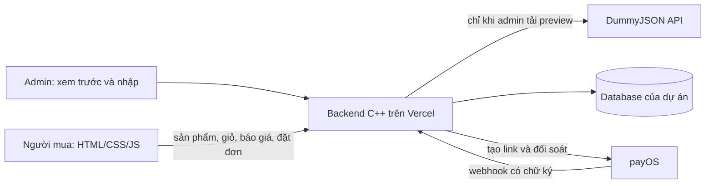

# Chọn API cho sàn độc lập, thanh toán payOS

Ngày rà soát: 22/10/2026. Quyết định của chủ dự án trong lượt này: **chưa có shop/nguồn hàng được ủy quyền; tiếp tục dữ liệu demo có quyền sử dụng**. Giỏ hàng, đơn hàng và thanh toán thuộc dự án; không tạo đơn/thu tiền bằng Shopee.

## Phạm vi đã đọc

- Đọc trang [giới thiệu Open Platform](https://open.shopee.com/developer-guide/4), đối chiếu hướng dẫn đăng ký/app/ủy quyền đã đọc ở lượt trước.
- Rà soát toàn bộ mục lục API Open Platform đang hiển thị: **31 nhóm, 455 mục**. Đây là số mục trong navigation ngày kiểm tra, không phải khẳng định đã đọc schema chi tiết của cả 455 API. Tên và nhóm được lưu trong [shopee-api-inventory.json](shopee-api-inventory.json).
- Đọc các nhóm offer, feed, short link, conversion/validated report của [Affiliate API List VN](https://affiliate.shopee.vn/open_api/list), cùng New Version Update. Đối chiếu chi tiết API danh mục/sản phẩm với tài liệu chính thức; phần liên quan trực tiếp được nêu dưới đây.
- Không gọi API Shopee bằng tài khoản/credential thật, không tạo app/đơn/ủy quyền shop, không lấy API nội bộ/cookie tài khoản. Đọc được tài liệu không chứng minh đã có quyền gọi API.

## Kết luận áp dụng

**Không có API Shopee nào được bật cho nguồn hàng demo và checkout payOS trong lượt này.** API quản trị shop cần ủy quyền; dữ liệu Affiliate phục vụ tiếp thị qua link Shopee. Thay một nút thanh toán không biến offer thành nguồn hàng hoặc đơn thuộc hệ thống của mình.

Theo lựa chọn demo của chủ dự án, phần được triển khai là **API catalog DummyJSON gọi trực tiếp bằng C++**, nhập vào database của dự án sau bước xem trước. Hàng nhập là dữ liệu minh họa; vẫn đi qua giỏ/quote/order C++ và payOS/COD hiện có. Không dùng đơn, voucher, hoa hồng, tồn kho hay trạng thái thanh toán Shopee cho những đơn này.

## Affiliate: phân loại tất cả nhóm trong API List

| Mục tài liệu                  | Operation hiện tại đọc được | Phù hợp với checkout payOS của dự án?                                                              |
| ----------------------------- | --------------------------- | -------------------------------------------------------------------------------------------------- |
| Get Shopee Offer List         | `shopeeOfferV2`             | Không: danh sách offer/chiến dịch và link tiếp thị                                                 |
| Get Brand Offer List          | `shopOfferV2`               | Không: tài liệu hiện ghi Get Shop Offer List, dù menu còn tên Brand                                |
| Get Product Offer List        | `productOfferV2`            | Không dùng làm kho bán nội bộ; phù hợp một trang Affiliate dẫn sang Shopee nếu sau này đổi yêu cầu |
| Get Product Feed Offer List   | `listItemFeeds`             | Feed FULL/DELTA của Affiliate; không phải quyền bán hàng của các shop đó                           |
| Get Product Feed Offer Detail | `getItemFeedData`           | Đọc snapshot feed, tối đa 500 dòng/trang; vẫn thuộc mô hình Affiliate                              |
| Get Short Link                | `generateShortLink`         | Tạo link sang Shopee, không tạo link payOS                                                         |
| Get Conversion Report         | `conversionReport`          | Báo cáo chuyển đổi/hoa hồng Shopee, không phải doanh thu đơn payOS                                 |
| Get Validated Report          | `validatedReport`           | Báo cáo hoa hồng đã đối soát, không phải xác nhận ngân hàng payOS                                  |
| New Version Update            | Tài liệu thay đổi           | Bản cập nhật 05/03/2026 giới thiệu feed FULL/DELTA và product_short link cho Affiliate             |

Nguồn: [Offer](https://affiliate.shopee.vn/open_api/list?type=shopee_offer), [Shop](https://affiliate.shopee.vn/open_api/list?type=brand_offer), [Product](https://affiliate.shopee.vn/open_api/list?type=product_offer), [Feed list](https://affiliate.shopee.vn/open_api/list?type=product_feed_offer), [Feed detail](https://affiliate.shopee.vn/open_api/list?type=product_feed_offer_detail), [Short link](https://affiliate.shopee.vn/open_api/list?type=short_link), [Conversion](https://affiliate.shopee.vn/open_api/list?type=conversion_report), [Validated](https://affiliate.shopee.vn/open_api/list?type=validation_report), [Updates](https://affiliate.shopee.vn/open_api/list?type=update_instructions).

## Open Platform: API catalog có thể cân nhắc sau này

| API                                               | Mục đích                                              | Điều kiện trước khi thêm                                               |
| ------------------------------------------------- | ----------------------------------------------------- | ---------------------------------------------------------------------- |
| `v2.product.get_category`                         | Cây danh mục, id/parent/tên; VN hỗ trợ `language=vi`  | App có quyền và shop đã ủy quyền                                       |
| `v2.product.get_item_list`                        | Danh sách ID sản phẩm của shop; phân trang tối đa 100 | Shop được phép; không phải tìm toàn bộ sàn                             |
| `v2.product.get_item_base_info`                   | Chi tiết theo danh sách ID, tối đa 50                 | Quyền app/shop và quyền sử dụng dữ liệu                                |
| `v2.product.get_model_list`                       | Biến thể, giá và stock theo item                      | Phải thiết kế quy tắc ánh xạ/giữ kho trước khi đồng bộ                 |
| Nhóm Product attributes/brand, ShopCategory, Shop | Thuộc tính, thương hiệu, danh mục shop, hồ sơ shop    | Chỉ thêm khi có nhu cầu bán đa kênh và được cấp quyền; chưa triển khai |

Nguồn chi tiết: [get_category](https://open.shopee.com/documents/v2/v2.product.get_category?module=89&type=1), [get_item_list](https://open.shopee.com/documents/v2/v2.product.get_item_list?module=89&type=1), [get_item_base_info](https://open.shopee.com/documents/v2/v2.product.get_item_base_info?module=89&type=1), [get_model_list](https://open.shopee.com/documents/v2/v2.product.get_model_list?module=89&type=1).

Khi đủ điều kiện, có thể làm connector C++ cho shop được ủy quyền để phục vụ vận hành đúng phạm vi Shopee chấp thuận. Điều đó không tự cấp quyền lấy dữ liệu shop bất kỳ để đưa giao dịch ra ngoài Shopee. Hướng dẫn đăng ký hiện nêu Preferred/Mall cho người bán VN và giới hạn hoạt động trích listing để giao dịch ngoài nền tảng trong hồ sơ ISV. Xem [đăng ký](https://open.shopee.com/developer-guide/12), [app](https://open.shopee.com/developer-guide/14), [ủy quyền](https://open.shopee.com/developer-guide/20).

## Các nhóm còn lại của Open Platform

| Nhóm đã kiểm kê                                                                    | Quyết định cho dự án hiện tại                                                                                             |
| ---------------------------------------------------------------------------------- | ------------------------------------------------------------------------------------------------------------------------- |
| Payment                                                                            | Không tích hợp: thu/hoàn/đối soát nội bộ dùng payOS và quy trình admin hiện tại                                           |
| Order, Returns                                                                     | Không dùng cho đơn nội bộ; C++ quản lý đơn và trả hàng của chính dự án                                                    |
| Logistics, FirstMile, SBS, FBS                                                     | Không thay thế đơn vị vận chuyển cho đơn payOS; tiếp tục admin demo giao vận                                              |
| Discount, Bundle Deal, Add-On Deal, Voucher, ShopFlashSale, Follow Prize, TopPicks | Các API này quản lý khuyến mại trên Shopee; voucher/khuyến mại nội bộ tiếp tục do C++ quyết định                          |
| Public, Push                                                                       | Chỉ cần khi triển khai kết nối shop thật: token/refresh/notification thuộc connector, không phải auth người mua của dự án |
| Media, MediaSpace                                                                  | Không cần cho ảnh demo hiện tại; upload ảnh của shop dùng Supabase Storage qua C++                                        |
| GlobalProduct, Merchant                                                            | Không có yêu cầu quản lý shop/merchant xuyên biên giới                                                                    |
| AMS, Ads, Video, Livestream, BrandPortal                                           | Không có yêu cầu quảng cáo, Affiliate seller campaign, livestream hoặc phân tích nội dung Shopee                          |
| AccountHealth, Buybox, BusinessInsights                                            | Không cần cho bài tập; một số chức năng còn giới hạn thị trường như BR                                                    |

Không khai báo các API này là “đã tích hợp” chỉ vì đã có tên trong tài liệu. Toàn bộ nghiệp vụ nội bộ vẫn dùng ID, database và API C++ của dự án.

## API được thêm thật trong lượt này

| API dự án                         | Quyền / dữ liệu                                                                                                        |
| --------------------------------- | ---------------------------------------------------------------------------------------------------------------------- |
| `GET /api/admin/catalog/status`   | Admin: nguồn DummyJSON, mode demo, không cần key, lần nhập gần nhất, payment_provider=payos                            |
| `POST /api/admin/catalog/preview` | Admin + Origin + CSRF; `{limit:1..300}`. C++ tải category-list/products, bổ sung mẫu có nhãn khi thiếu, trả preview 15 phút |
| `POST /api/admin/catalog/commit`  | Admin + Origin + CSRF; `{preview_token}`. Chỉ nhập snapshot server đã lưu; token dùng một lần, giữ nguyên hàng đã có   |

Provider được gọi: `GET https://dummyjson.com/products/category-list` và `GET https://dummyjson.com/products?limit=0&select=id,title,description,category,price,thumbnail`. Nguồn chính thức giới thiệu dữ liệu sản phẩm cho thử nghiệm/prototype ecommerce: [DummyJSON Products](https://dummyjson.com/docs/products).

Chữ ký nguồn Shopee/AppId/Partner Key không được yêu cầu hoặc sử dụng trong chế độ demo này. Không có biến môi trường mới cần bạn chuẩn bị.

## Quy trình admin và bảo toàn dữ liệu

1. Admin → Sản phẩm → **Lấy sản phẩm demo từ API**.
2. Chọn 1–300 sản phẩm, mặc định 300 → **Tải bản xem trước**.
3. Kiểm tra tên, danh mục tiếng Việt, giá VNĐ minh họa, số lượng mới/đã tồn tại.
4. Chọn **Nhập bản xem trước vào shop**. Hệ thống chỉ thêm ID mới, không tự restock hoặc ghi đè sửa đổi của admin.
5. Sản phẩm mới xuất hiện ở trang mua sắm, dùng checkout nội bộ và payOS/COD. Đây vẫn là hàng demo, không cung cấp hàng thật.
6. Khi nguồn API lỗi, dữ liệu đang có vẫn hoạt động; nút **Dùng demo đóng gói** là lựa chọn rõ ràng, không âm thầm giả báo API thành công.

Server chỉ gọi HTTPS tới hostname cố định, không theo redirect, giới hạn phản hồi 2MiB, giới hạn thời gian và không giữ transaction SQL trong lúc chờ mạng. Preview bị giới hạn tần suất, gắn với admin và lưu token dạng hash. Không nhập review, danh tính reviewer, số bán, tồn kho hoặc chính sách trả hàng của provider thành sự thật của shop.

Giá minh họa và tồn kho ban đầu 20 là quy tắc C++ của dữ liệu demo; không phải tỷ giá trực tiếp hoặc stock của Shopee/DummyJSON. Ngày giờ, snapshot và token đều được kiểm tra ở server; frontend chỉ hiển thị/gửi thao tác.

## Kiểm thử triển khai

Nâng cấp 300 sản phẩm: API nguồn hiện có 194 sản phẩm tổng cộng (kiểm tra trực tiếp 23/10/2026 giờ Việt Nam), nên không thể lấy 300 listing gốc khác nhau từ DummyJSON. C++ chọn sản phẩm tiêu dùng hợp lệ, loại xe/giá ngoài giới hạn; nếu thiếu thì tạo mẫu mô phỏng có ID `demo-shoppe-<id-gốc>-<số-mẫu>`, nguồn `ShoppeDemo`, tên có “Mẫu demo”, mô tả giải thích ảnh chỉ minh họa. Listing nguồn giữ ID `demo-dummyjson-<id>` và nguồn `DummyJSON`; preview/import trả nguồn hỗn hợp và số mẫu được tạo. ID ổn định và tách riêng giúp nhập lại không trùng hoặc ghi đè hàng cũ. Không có thêm API Shopee hoặc key mới.

Các kết quả dưới đây là mốc triển khai 60 sản phẩm trước khi nâng cấp; kết quả kiểm thử 300 sản phẩm được ghi riêng sau khi xác nhận Production.

- C++ CTest: 4/4, gồm catalog validation, preview/commit, token hết hạn/replay và giữ hàng đã sửa.
- HTTP: 16/16 trên SQLite và 16/16 trên PostgreSQL thử nghiệm riêng; có chặn user thường, CSRF/Origin, limit sai, token giả và method sai trước khi gọi provider.
- Live C++ HTTPS: lấy/kiểm tra 60 sản phẩm từ hai endpoint công khai, không dùng credential.
- UI fixture: admin tải preview 60 → nhập 60 → storefront có 72 sản phẩm (12 seed riêng + 60 nhập); dữ liệu demo được gắn nhãn, không lỗi JavaScript.
- Frontend syntax/build, secret scan và diff check đạt.

## Kết quả Production đã xác nhận

- Bản ứng dụng `97bdcfda70ae9bdfddfcf35491203e7d19eeae51` đã triển khai READY tại [shoppec.vercel.app](https://shoppec.vercel.app), deployment `dpl_CtHaWHu8nWryGjvKTsYpPNDrAP1F`, vùng Singapore (`sin1`).
- [GitHub Actions của đúng commit](https://github.com/hoquan2007/Shoppe-C-/actions/runs/39816561909) đạt: kiểm thử SQLite/PostgreSQL và build container.
- Sau khi chủ dự án cho phép nhập demo vào Production, kiểm tra ngày 22/10/2026 lúc 16:50 UTC: preview 60 sản phẩm; nhập **30 mới**, bỏ qua **30 đã có**; tổng catalog công khai **60 sản phẩm**.
- So sánh toàn bộ 30 sản phẩm có trước và các biến thể: tên, ảnh, danh mục, mô tả, trạng thái, giá và tồn kho đều giữ nguyên.
- API thực tế trả đúng: chưa đăng nhập `401`, preview thiếu CSRF `403`, preview hợp lệ `200`, commit `200`, dùng lại token `409`. Trạng thái đồng bộ xác nhận `source=DummyJSON`, `is_demo=true`, `payment_provider=payos`; không lộ token hash.
- Lần kiểm tra này chỉ đăng nhập/xem trước/nhập catalog/đăng xuất, **không tạo đơn hoặc thực hiện thanh toán**. Chưa có kiểm thử chuyển tiền thật trong lượt này.
- Không tìm thấy log mức error/fatal của deployment trong cửa sổ 15 phút kiểm tra; đây là kết quả tại thời điểm kiểm tra, không phải cam kết không có lỗi về sau.

Biên bản chi tiết riêng tại máy: `artifacts/catalog-api-production-20261022.json` (không chứa mật khẩu, cookie, CSRF hoặc preview token). Tệp artifact không đưa vào Git.

## Nâng cấp lên 300 sản phẩm — 23/10/2026 (giờ Việt Nam)

- C++ CTest 4/4, có kiểm tra nhập 300, ID không trùng, nguồn mô phỏng được gắn nhãn, nhập lại bỏ qua đủ 300 và giữ giá/tồn kho/chỉnh sửa cũ. HTTP SQLite 16/16, frontend build và quét key đạt.
- [CI Linux của ứng dụng 169ab93](https://github.com/hoquan2007/Shoppe-C-/actions/runs/39819202252) đạt cả SQLite/PostgreSQL và container.
- Production lúc 00:08 ngày 23/10/2026: **60 → 300**, nhập mới **240**, bỏ qua **60**. Đối chiếu nội dung/giá/tồn kho của toàn bộ 60 sản phẩm trước đó giữ nguyên.
- Catalog gồm **177 listing DummyJSON hợp lệ và 123 mẫu mô phỏng Shoppe**. Không gọi đây là 300 listing gốc khác nhau của DummyJSON hoặc Shopee. Phần mở rộng dùng cùng ảnh minh họa với sản phẩm gốc và có nhãn “Mẫu demo”.
- Kiểm tra Production: preview 300 thành công, thiếu CSRF trả 403, commit 200, replay 409, catalog công khai có đúng 300. Không tạo đơn hoặc chuyển tiền trong lần nhập này. Biên bản riêng tại `artifacts/catalog-300-production-20261023.json`.
- Bản cuối `d266057ca7116188917dc7dd109006d8332e42f4` đã READY tại [shoppec.vercel.app](https://shoppec.vercel.app/search), deployment `dpl_7LXB86MM2mE7b4xwaD7y59bD8Dri`, vùng `sin1`. [CI đúng commit cuối](https://github.com/hoquan2007/Shoppe-C-/actions/runs/39820181707) đạt.
- Trình duyệt Production xác nhận: 300 sản phẩm/25 trang; trang 25 có 12 thẻ; tìm “Mẫu demo” trả 123 sản phẩm có nhãn. Bản CSS cuối cho các nút phân trang xuống dòng. Kiểm tra ở viewport 390px: document width 375px (phần còn lại là thanh cuộn), không tràn ngang, 12 thẻ/trang và 25 liên kết phân trang; không có lỗi JavaScript được ghi nhận. Ảnh tại máy: `artifacts/catalog-300-mobile-20261023.png`.
- Không tìm thấy log error/fatal của deployment cuối trong cửa sổ 10 phút kiểm tra. Key và cấu hình payOS được giữ nguyên; không cần thêm credential cho catalog 300.
